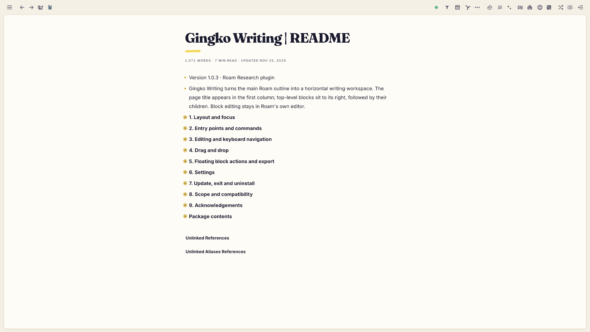
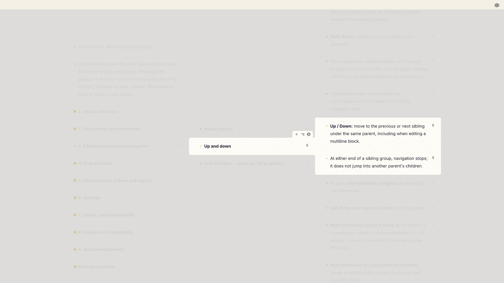

# Gingko Writing

Version 1.1.3 · Roam Research plugin

Gingko Writing turns the main Roam outline into a horizontal writing workspace. The page title appears in the first column; top-level blocks sit to its right, followed by their children. Block editing stays in Roam's own editor.

## See the difference

The same page and custom theme, before and after enabling Gingko Writing. The page text in the screenshots contains an older version label; the plugin version is 1.1.3.

**Before — standard Roam outline**

**After — horizontal writing workspace**

## 1. Layout and focus

- **Horizontal hierarchy:** successive outline levels occupy successive columns.
- **Editable page-title column:** the native page title sits to the left of the top-level blocks. A small `Page title` label distinguishes it from ordinary content. Editing it renames the page through Roam's native title editor.
- **Simplified title styling:** while this mode is active, the plugin suppresses title decorations, pseudo-elements and extra title-container elements, and normalizes title typography. It removes these overrides on exit. Highly unusual theme markup may still need a compatibility adjustment.
- **Theme-derived colors:** backgrounds and text colors come from the existing page. There is no fixed blue canvas.
- **No native hierarchy guide lines:** the vertical `rm-multibar` guides are hidden in transformed columns; draggable bullets remain available.
- **Continuous sibling groups:** children of the same parent share one background surface. Ordinary blocks have no individual frames; the selected branch uses the same theme-derived paper color as the floating toolbar.
- **Connected branches:** selected cards and their child groups meet at their shared edge when visible spans overlap. Ancestors use a context shade and unrelated groups retain separate surfaces.
- **Branch highlighting:** only the current block and its actual descendants use the bright surface. Ancestors, siblings and unrelated branches are dimmed. Other branches use a subdued group surface and adjustable text opacity; their bullets remain reachable. For example, when B owns 4 and 5, children of A and C are not highlighted as B's children.
- **Compact groups:** adjacent cards and groups meet without spacer rows. Theme-derived surface shading distinguishes branches; current and descendant surfaces share the same paper color and one rounded outer contour.
- **Writing focus:** the selected block/caret is positioned around the vertical center as you edit.
- **Stable horizontal position:** moving between siblings keeps the current column position, whether or not the next block has children.
- **Independent column browsing:** vertical wheel/touch movement scrolls the column under the pointer. Parent and neighboring columns keep their positions. Horizontal trackpad movement or Shift + wheel browses across columns. Typing or explicit focus/navigation resumes automatic positioning.
- **Long child groups:** groups taller than the comfortable reading area start near their parent, keeping their first child visible rather than centering the entire group.
- **Column sizing:** columns adapt to viewport width and hierarchy depth. `Alt + mouse wheel` adjusts column width for the current session.
- **Side margins:** adjustable breathing room on both sides of the workspace.
- **Zen Mode integration:** entering Gingko requests Roam's Zen Mode; leaving requests exit from Zen Mode too. The plugin uses the native command when available, with the usual shortcut chord as a fallback.

## 2. Entry points and commands

- **One top-bar icon:** click to enter or leave Gingko Writing. There is no separate top-bar download icon.
- **Double-click the icon:** open settings. Right-click provides the same settings shortcut.
- **Command palette:** only two commands are registered:
  - `Gingko Writing: Toggle`
  - `Gingko Writing: Settings`
- **Custom shortcut:** find `Gingko Writing: Toggle` under Roam **Settings → Hotkeys** and assign a shortcut. No default key combination is reserved.
- Single-click is delayed briefly so it can be distinguished from double-click.

## 3. Editing and keyboard navigation

### Native editing

- Click block text to edit with Roam's native editor; double-click is not required.
- Native block text, references and ordinary editing remain in the existing outline DOM. The plugin does not copy your graph into a separate editor.
- **Enter:** creates the next sibling. At the end of a parent that has children, the plugin explicitly creates a sibling instead of entering that parent's child list. Other Enter behavior, including text splitting, is left to Roam.
- **Tab / Shift+Tab:** native indent/outdent behavior is retained. A Tab immediately following the plugin-handled Enter is queued while the new sibling is being created, so it can be indented beneath the preceding block.
- **Shift+Enter:** native line-break behavior is retained.
- Newly created or selected blocks are focused through Roam's focus API, and the plugin checks that the actual target editor has received focus.
- Composition input and modifier-key combinations are not treated as ordinary navigation keys.

### Up and down

- **Up / Down:** move normally through visual lines inside the current block, including soft-wrapped text. Only an additional Up on the first line or Down on the last line switches to the previous or next sibling under the same parent. Up enters the previous block at its end; Down enters the next at its start.
- At either end of a sibling group, navigation stops; it does not jump into another parent's children.

### Left and right — optional, off by default

Enable **Left/right block navigation** in settings to use these rules:

- **Left at the very start of a block:** go to its parent.
- **Right at the very end of a block:** go to a child. If a previously visited child is remembered for this session, return to that child; otherwise use the first child.
- **Right at the end of a block with no children:** create an empty child, expand the parent and focus the child.
- In the middle of the text, Left/Right retain normal text-cursor movement. Navigation requires a focused native editor and a collapsed selection. Holding an arrow does not repeatedly navigate or create empty descendants.
- Selected text is not treated as a navigation boundary.
- From a top-level block, Left can focus the page title. From the title, Right can navigate into the page's children. The page title has no parent or sibling navigation.

## 4. Drag and drop

- Drag a block by its existing Roam bullet/control handle.
- Drop in the **top quarter** of a target card to place the dragged block before it.
- Drop in the **bottom quarter** to place it after the target.
- Drop near the **right edge, within the middle half**, to make it a child of the target.
- An edge indicator shows the active drop destination. The center of a card is not a drop destination.
- The whole branch moves using Roam's block-move API; descendant blocks remain attached to it.
- Dropping a block into itself or into one of its own descendants is rejected.
- The page-title card is not a draggable block.

## 5. Floating block actions and export

Three optional buttons appear above the selected ordinary block:

1. **Add sibling** — insert an empty block after the selected block.
2. **Add child** — append an empty child, expand the parent and focus the child.
3. **Export branch** — download the selected block and its descendants as a Markdown outline, preserving sibling order.

Export is text-based. It is not a graph backup, image/PDF exporter, or a full reproduction of every rendered Roam component. Linked resources are not downloaded or bundled.

The buttons are hidden while recognized command palettes, dialogs, popovers or the plugin settings are open. They can also be switched off entirely. They do not appear on the page-title card.

## 6. Settings

Open settings by double-clicking/right-clicking the icon or running `Gingko Writing: Settings`.

| Setting | Purpose | Initial value / range |
| --- | --- | --- |
| Block buttons | Show the three floating block actions | On |
| Paper texture | Fine irregular paper fibers inside the highlighted branch only | On |
| Left/right block navigation | Enable boundary-based parent/child navigation | Off |
| Side margins | Content breathing room; the canvas itself fills the workspace | 40 px; 16–120 px |
| Inactive text opacity | Visibility of unrelated blocks; smaller means fainter | 18%; 2–80% |

- Hovering any card restores its text to full opacity, including siblings, ancestors, unrelated blocks and the page title. Moving away restores inactive opacity; hovering does not change the selected branch.
- Existing preferences from the earlier script are read on first use, so your values may differ from the initial values above.
- In the plugin version, changed preferences are stored through Roam's extension settings when writing is permitted, with a local copy for compatibility. The `roam/js` fallback stores preferences locally.
- Column zoom and remembered child navigation are session-only.

## 7. Update, exit and uninstall

- Click the icon or run `Gingko Writing: Toggle` to leave the view and request exit from Zen Mode.
- To update a local plugin, replace the files in the same folder and reload the developer extension. The archive always uses the stable `Gingko-Writing` folder name; only the release ZIP name and internal version change.
- Disabling/unloading the plugin removes its icon, settings dialog, floating controls, registered commands, listeners and injected styles, and restores marked outline/title elements.
- If disabled while active, it also requests exit from Zen Mode.
- Removing the plugin does not delete your pages or blocks. Normal edits, title renames and moves made while using it remain real changes in your graph.
- For the standalone script, stop the `roam/js` block and reload Roam to fully unload it.

## 8. Scope and compatibility

- Designed for the main outline. Linked references, query contents and embedded outlines are not independently transformed into the horizontal hierarchy.
- A page with no visible block cannot currently enter this mode; create a normal block first.
- The page-title column requires Roam's native page-title container. A zoomed block view without that container has no separate title card.
- It uses Roam DOM selectors as well as public APIs. Future Roam markup changes or plugins that rewrite titles, keyboard handling, scrolling or Zen Mode can require adjustments.
- Zen detection and switching are best-effort; a notice is shown when a contradictory state is detected. Customized or unavailable Zen shortcuts may prevent switching.
- Syntax, focus/navigation/layout regression checks and mocked plugin load/unload/reload checks passed. The author tested and approved this version in a live Roam graph. Compatibility with every theme and plugin combination is not guaranteed.
- There are no bundled runtime dependencies or remote script downloads. User-triggered export downloads a local Markdown file; native Roam graph changes and extension preferences use Roam's own APIs.

## 9. Acknowledgements

Thank you to **[Gingko Writer](https://gingkowriter.com/)** for the inspiration: writing as a horizontal tree, keeping the bigger picture and nearby detail visible together.

Thank you also to **[Obsidian Lineage](https://github.com/ycnmhd/obsidian-lineage)** for providing a useful reference for this interaction approach within an outliner-based writing tool.

Gingko Writing is an independent Roam adaptation. It is not an official Gingko Writer product, is not affiliated with either project, and is not a complete port of either application. The acknowledgements describe design inspiration and interaction reference, not endorsement.

## Package contents

- `extension.js` — Roam plugin entry point with `onload` / `onunload` lifecycle.
- `roam-js.js` — standalone fallback for the existing script workflow.
- `README.md` — features, controls, installation, scope and acknowledgements.
- `CHANGELOG.md` — release notes.
- `package.json` — version metadata; no build step or npm installation is required.

## Development

No build step or runtime dependencies are required. `extension.js` is the Roam Depot entry point; `roam-js.js` is an alternative standalone script and must not run alongside the extension.

Run the regression suite with `npm test`. An optional synthetic Chromium test is available via `npm run test:browser` after installing Playwright and its Chromium browser. It uses a local Roam DOM/API fixture, not a live graph.

The plugin uses UID-scoped pulls and does not scan the whole graph, delete blocks/files, or rewrite block text. Exiting or unloading invalidates pending operations before any subsequent graph write. A write already submitted to Roam cannot be recalled.

MIT licensed. See [LICENSE](LICENSE).
